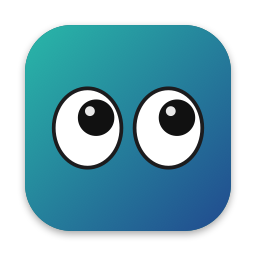
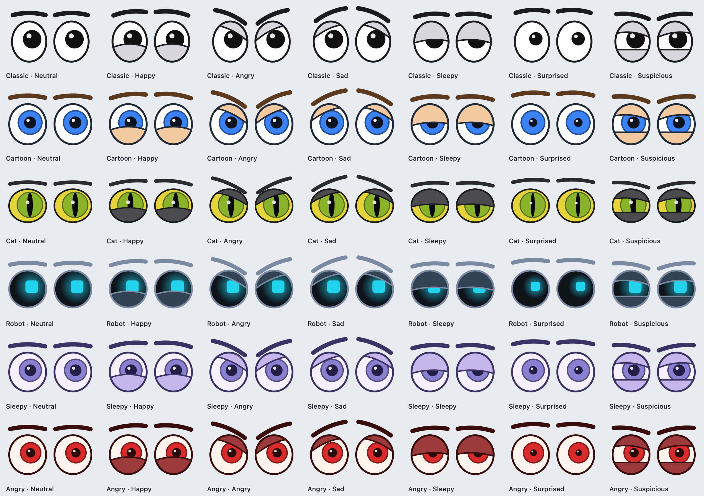
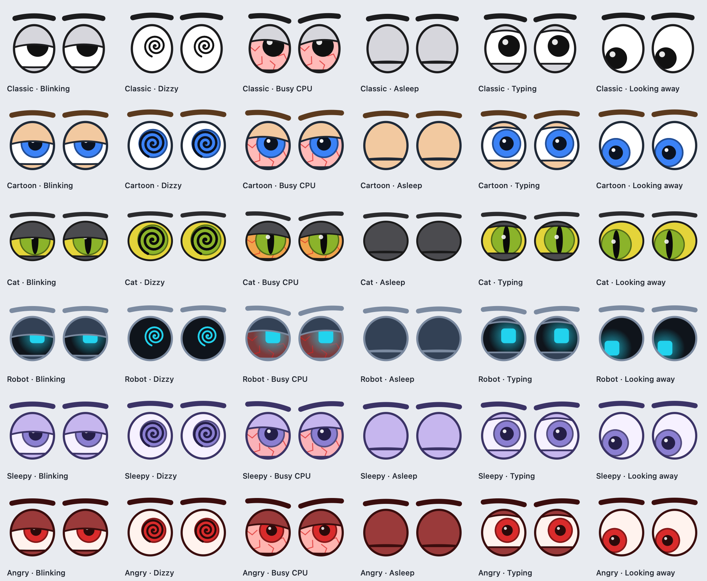

<p align="center">
  
</p>

<h1 align="center">MacEye</h1>

<p align="center">
  Animated eyes for your Mac's menu bar and desktop. They follow the pointer, blink, sleep, react to what you do, and tell you a few useful things about your Mac.
</p>

<p align="center">
  <a href="https://github.com/dineshjngr/maceye/actions/workflows/ci.yml"></a>
  <a href="LICENSE"></a>
  
</p>

## Overview

MacEye is a small, free menu bar app in the tradition of the classic `xeyes` desktop toy. A pair of eyes sits in your menu bar (or floats on your desktop) and watches the pointer.

It is written in Swift with no third-party code. **It runs fully on your Mac and never opens a network connection.**



## Key features

**Look**
- Six themes: Classic, Cartoon, Cat, Robot, Sleepy and Angry. Or pick your own colours.
- Moods with eyelids and eyebrows: neutral, happy, angry, sad, sleepy, surprised, suspicious, or automatic.
- One to eight eyes, with adjustable size and spacing.
- Pupils grow in Dark Mode and shrink in Light Mode.

**Life**
- Natural random blinking. The eyes fall asleep when you stop using the Mac.
- Reactions: wide eyes when the pointer moves fast, dizzy spirals when you shake it, a squint while you type.
- Optional "googly" physics: pupils wobble, overshoot and bounce.
- Optional: look at the text cursor while you type.

**Useful**
- Red, tired eyes when the CPU is very busy. Sleepy eyes when the battery is low.
- Eye-break reminder based on the 20-20-20 rule.
- Eyes close while the microphone or camera is in use.
- Find My Pointer: a shortcut that highlights the pointer and makes the eyes stare at it.

**Placement and control**
- Menu bar eyes, floating desktop eyes you can drag anywhere, and one pair per display.
- Desktop widgets, one per theme.
- System-wide keyboard shortcuts.
- `maceye://` links for the Shortcuts app and scripts.
- Optional settings sync between your Macs through your own iCloud Drive folder.



The pictures above are drawn by the app's own renderer (`Scripts/make-previews.sh`). They are not screen captures.

## System requirements

| | |
|---|---|
| To run | macOS 15 (Sequoia) or later, Apple silicon or Intel |
| To build | Xcode 16 or later |

MacEye was developed and tested on macOS 27 on Apple silicon with Xcode 27. Earlier supported versions and Intel Macs should work but have not been tested yet. Reports are welcome.

## Download

Get the latest `MacEye-x.y.z.zip` from the [Releases page](https://github.com/dineshjngr/maceye/releases/latest).

The download is **not notarized by Apple** (see [Code signing and Gatekeeper](#code-signing-and-gatekeeper)). If you prefer not to bypass Gatekeeper, [build from source](#build-from-source) instead. It takes one command.

## Installation

1. Unzip the download.
2. Move `MacEye.app` to your `Applications` folder.
3. Open it. macOS will refuse the first time, because the app is not notarized.
4. Open **System Settings › Privacy & Security**, scroll down, and click **Open Anyway** next to the MacEye message. Confirm once.

As an alternative to step 4, you can remove the download flag in Terminal:

```sh
xattr -dr com.apple.quarantine /Applications/MacEye.app
```

MacEye then appears in the menu bar. It has no Dock icon. The settings window opens on first launch.

### Code signing and Gatekeeper

- Release builds are **ad-hoc signed** and **not notarized**. Notarization needs a paid Apple Developer account, which this project does not have.
- Because of that, Gatekeeper blocks the first launch of a downloaded copy until you approve it as described above.
- A copy you build yourself is not flagged as downloaded, so it opens without that step.
- Each build has a different ad-hoc signature. macOS ties some permissions (such as Accessibility) to the signature, so you may need to grant them again after updating.

## Build from source

```sh
git clone https://github.com/dineshjngr/maceye.git
cd maceye
./build.sh
```

The app is written to `build/Release/MacEye.app`. Use `./build.sh run` to build and open it.

You can also open `MacEye.xcodeproj` in Xcode and run the **MacEye** target. No developer account is needed; the project is set to "Sign to Run Locally".

Other scripts:

| Script | What it does |
|---|---|
| `Scripts/test.sh` | Runs the automated checks. Launches nothing. |
| `Scripts/package.sh` | Builds and creates the release zip. |
| `Scripts/make-previews.sh` | Redraws the pictures in `docs/images`. |

If the project is inside a folder synced by iCloud Drive or a similar service, set a build folder outside it:

```sh
MACEYE_BUILD_DIR="$HOME/Library/Caches/MacEyeBuild" ./build.sh
```

## Usage

- **Click an eye** to make it blink.
- **Right-click** (or Control-click) the eyes for the menu: blink, Find My Pointer, mood, theme, menu bar and floating eyes, settings, quit.
- **Drag** the floating eyes to move them.
- **Open the app again** from Finder or Spotlight to show the settings window. This is the way back if you hid every pair of eyes.

### Keyboard shortcuts

These work in every app. Change or remove them in **Settings › Control**.

| Default | Action |
|---|---|
| ⌃⌥⌘B | Blink |
| ⌃⌥⌘H | Hide or show the eyes |
| ⌃⌥⌘M | Change mood |
| ⌃⌥⌘F | Find my pointer |

### Links for Shortcuts and scripts

Use these with the **Open URLs** action in the Shortcuts app, or with `open` in a script:

```
maceye://blink            maceye://blink/left   maceye://blink/right
maceye://find
maceye://mood/happy       (auto, neutral, happy, angry, sad, sleepy, surprised, suspicious, next)
maceye://theme/cat        (classic, cartoon, cat, robot, sleepy, angry)
maceye://floating/on      (on, off, toggle)
maceye://menubar/toggle
maceye://hide/toggle
maceye://physics/toggle
maceye://eyebrows/toggle
maceye://settings
```

### Widgets

Right-click the desktop, choose **Edit Widgets**, and search for MacEye. Widgets cannot animate or follow the pointer, so the widget eyes look in a new direction every five minutes and sleep at night.

## Configuration and settings

All settings are in the settings window. There are no configuration files to edit and no accounts or keys to set up.

| Tab | Settings |
|---|---|
| Look | Theme, custom colours, mood, eyebrows, eyelids, number of eyes, spacing, pupil size by appearance |
| Life | Blinking, sleep when idle, reactions, googly physics, follow the text cursor |
| Useful | CPU and battery signals, eye-break reminder, microphone and camera signal, Find My Pointer |
| Placement | Menu bar eyes and size, floating eyes and size, one pair per display, keep on top |
| Control | Keyboard shortcuts, click to blink, link reference |
| General | Open at login, hide all eyes, iCloud Drive sync, reset |

Settings are stored in the app's preferences (`com.maceye.app`).

### Privacy

MacEye has no analytics, no accounts and no network code. This is what it reads, all locally:

| What | Why | Permission needed |
|---|---|---|
| Pointer position, time since last input | Follow the pointer, squint while typing, sleep, eye breaks | None |
| CPU load, battery level | Tired and sleepy eyes | None |
| Whether the microphone or a camera is in use | Close the eyes. Only the "in use" flag is read; nothing is recorded | None |
| Position of the text cursor | "Look at where you are typing" (off by default) | Accessibility, only if you turn this on |
| One settings file in iCloud Drive | Sync between Macs (off by default). macOS does the syncing | None |

### Uninstalling

Quit MacEye, delete `MacEye.app`, and remove these if they exist:

```
~/Library/Preferences/com.maceye.app.plist
~/Library/Containers/com.maceye.app.widget
~/Library/Application Scripts/com.maceye.app.widget
~/Library/Mobile Documents/com~apple~CloudDocs/MacEye
```

## Technologies used

- **Swift 5 language mode**, built with Xcode
- **AppKit** for the menu bar item, floating windows and menus
- **Core Animation** for the live eyes, **Core Graphics** for widgets, the icon and previews
- **SwiftUI** for the settings window and widgets
- **WidgetKit** and **App Intents**
- **Carbon hot keys** for system-wide shortcuts, which need no permission
- **Core Audio**, **Core Media I/O** and **IOKit** for the microphone, camera, CPU and battery status
- No third-party dependencies

## Project structure

```
MacEye/               The app
  MacEyeApp.swift       Entry point, menu, link commands, developer tools
  EyeEngine.swift       Animation loop: gaze, blinking, sleep, moods, reactions
  EyesView.swift        The view that hosts the eyes and handles clicks and dragging
  EyeLayers.swift       Core Animation layers of one eye
  Controllers.swift     Menu bar item and floating windows
  Monitors.swift        CPU, battery, microphone and camera status, text cursor position
  HotKeys.swift         Keyboard shortcuts and the shortcut recorder
  Config.swift          Settings model and storage
  SettingsView.swift    Settings window
  SettingsSync.swift    Optional iCloud Drive file sync
  Intents.swift         Shortcuts actions
MacEyeWidget/         Desktop widgets
Shared/               Code used by the app, the widgets and the scripts
  Theme.swift           Colours, themes, moods and poses
  EyeRenderer.swift     Layout and the Core Graphics renderer
  IntentEnums.swift     Mood and theme choices for App Intents
Config/               Info.plist additions and entitlements
Scripts/              Icon, preview, test and packaging scripts
Tests/                Automated checks
docs/images/          README pictures (generated)
.github/              Issue and pull request templates, CI and release workflows
```

## Known limitations

- **Not notarized.** See [Code signing and Gatekeeper](#code-signing-and-gatekeeper).
- **Shortcuts app actions** (Blink Eyes, Set Eye Mood and others) are built in, but macOS only lists them for apps signed with an Apple developer team. Use the `maceye://` links until then.
- **Widgets** from an ad-hoc signed build may not show up in the widget gallery on every macOS version. This has not been confirmed either way yet.
- **Following the text cursor** needs Accessibility access and only works in apps that report the cursor position. Otherwise the eyes look at the front window.
- With **several displays**, the menu bar eyes on displays you are not using refresh a few times a second instead of every frame. This keeps CPU use low.
- **English only.** There are no translations yet.
- Tested on one Mac so far (macOS 27, Apple silicon).
- No automatic updates. Watch the Releases page.

## Troubleshooting

**macOS says MacEye cannot be opened, or is damaged.**
Follow steps 3 and 4 under [Installation](#installation), or run the `xattr` command shown there.

**I cannot see the eyes in the menu bar.**
The menu bar may be full, or the item may be hidden behind the camera notch. Close some menu bar apps, or open MacEye again to show its settings and turn on **Placement › Show floating eyes on the desktop**.

**I hid all the eyes and cannot get them back.**
Open MacEye again from Finder or Spotlight. The settings window appears. Turn off **General › Hide all eyes**.

**The eyes stay closed.**
An app is using the microphone or camera. Turn off **Useful › Close the eyes while the microphone or camera is in use** if you do not want this.

**A keyboard shortcut does nothing.**
Another app may already use it. Record a different one in **Settings › Control**.

**"Look at where you are typing" stopped working after an update.**
macOS ties Accessibility access to the app's signature. Remove MacEye from **System Settings › Privacy & Security › Accessibility** and allow it again.

**The build fails with "resource fork, Finder information, or similar detritus not allowed".**
The project is in a synced folder. Set `MACEYE_BUILD_DIR` to a folder outside it, as shown under [Build from source](#build-from-source).

Still stuck? [Open an issue](https://github.com/dineshjngr/maceye/issues/new/choose).

## Contributing

Bug reports, ideas and pull requests are welcome. Please read [CONTRIBUTING.md](CONTRIBUTING.md) and the [Code of Conduct](CODE_OF_CONDUCT.md) first. To report a security problem, see [SECURITY.md](SECURITY.md).

## License

MacEye is released under the [MIT License](LICENSE). All code and artwork in this repository were made for this project and are covered by that licence. The app icon and preview pictures are drawn by the code in `Scripts/`.

MacEye is an independent project. It is not affiliated with or endorsed by Apple Inc. Mac and macOS are trademarks of Apple Inc.
